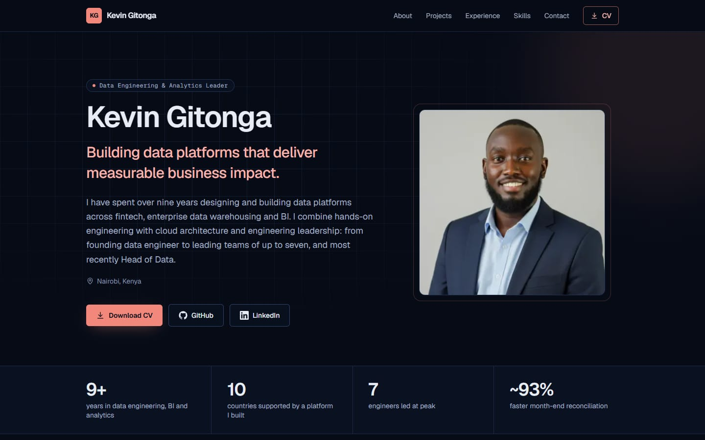

# Kevin Gitonga — Portfolio

Personal portfolio for Kevin Gitonga, Data Engineering & Analytics Leader.



## Stack

- [Next.js](https://nextjs.org) 16 (App Router, fully static prerender)
- TypeScript
- Tailwind CSS 4
- Hosted on Vercel

No backend, no tracking or analytics, no paid services.

## Project structure

```text
src/
├── app/
│   ├── layout.tsx            Metadata, fonts, JSON-LD, skip link
│   ├── page.tsx              Page composition
│   ├── opengraph-image.tsx   Social preview image (generated at build time)
│   ├── robots.ts · sitemap.ts
│   └── icon.svg · apple-icon.png
├── components/               One component per section (Hero, About, Projects, …)
├── content/site.ts           All portfolio copy in one place
└── lib/site-url.ts           Canonical URL resolution
public/
├── Kevin-Gitonga-CV.pdf      Downloadable CV
└── images/                   Portrait and FinFlow dashboard (WebP)
```

To update copy, edit `src/content/site.ts`. To replace the CV, overwrite
`public/Kevin-Gitonga-CV.pdf` with the same file name.

## Development

```bash
npm install
npm run dev      # http://localhost:3000
npm run lint
npm run build
```

## Configuration

| Variable | Purpose |
|---|---|
| `NEXT_PUBLIC_SITE_URL` | Optional. Canonical URL for metadata, sitemap and Open Graph (e.g. a custom domain). On Vercel the production URL is detected automatically. |

## Content notes

- FinFlow facts are taken from the public
  [finflow-data-platform](https://github.com/Kevin-Gitonga/finflow-data-platform)
  repository. FinFlow is an independent portfolio project using synthetic data.
- Projects B and C are anonymised professional case studies with no public code.

## Licence

Code: MIT. Personal content (text, CV, photographs) © Kevin Gitonga, all rights reserved.
